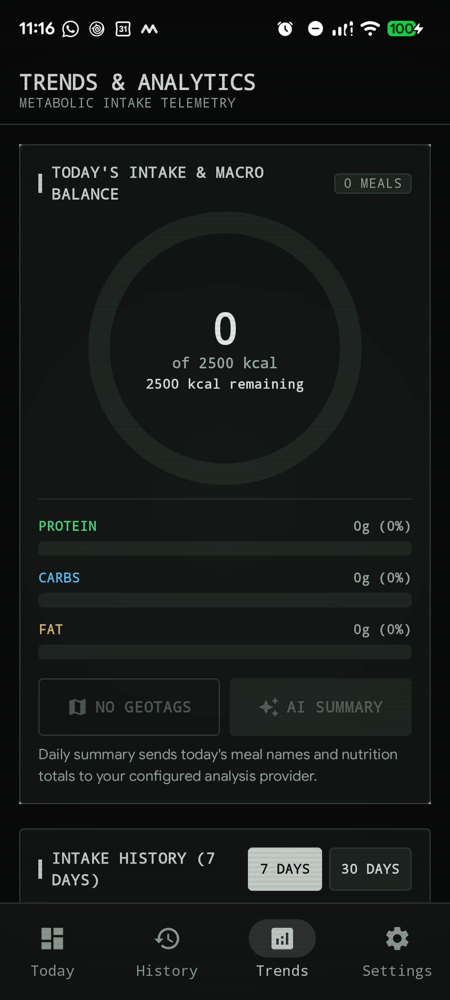
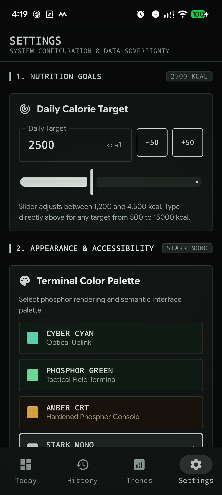

# MacroMandate 👁️📟

> **Sovereign Dietary Intelligence & Calorie Surveillance System**

**MacroMandate** is a high-performance, privacy-conscious nutrition and calorie surveillance application built for Android with Jetpack Compose. Designed with a retro tactical HUD / dystopian terminal aesthetic, it empowers users to log meals effortlessly via computer vision and barcode scanning, monitor daily macronutrient compliance, and maintain sovereign control over their health data.

---

## 📱 Visual Interface

<p align="center">
  
  
  
</p>

---

## ⚡ Key Features

- 📸 **AI Multimodal Vision**: Capture or select a meal, then review and edit the estimated calories and macros before saving. The default is OpenRouter's free model router.
- 🏷️ **Live ML Kit Barcode Scanner**: Instant product recognition with nutrition auto-population via OpenFoodFacts integration.
- 📺 **Simulated CRT Effects**: Hardware-accelerated scanlines, radial screen vignette, and phosphor bloom shader for an authentic terminal atmosphere.
- 🛡️ **Defensive Nutrition Sanitizer**: Automated validation against malformed JSON or string-encoded quantities, with programmatic $(P\times 4 + C\times 4 + F\times 9)$ fallback calculation.
- 🔒 **Android KeyStore AES-256 GCM Encryption**: Newly saved API tokens are encrypted using Android KeyStore and scoped to the configured endpoint.
- ✍️ **Manual Refueling Fallback**: Quickly record custom meals and macros directly when offline or in low-light environments.
- ✏️ **In-Place Meal Correction**: Edit food names, calories, macros, and liquid status at any time with immediate aggregate recalculation.
- 📊 **Metabolic Adherence Dashboard**: Real-time intake HUD displaying today's calories, remaining target delta, and macronutrient distribution.
- 📈 **7-Day Trend Intelligence**: Target-scaled weekly caloric and macro visualizations with at-a-glance day metrics.
- 📑 **Weekly Dossier Summary**: Synthesize 7-day nutritional intelligence debriefs with one-tap clipboard copy and markdown export.
- 🗺️ **Geospatial Surveillance**: Optional location tags for camera meals, with a separate choice to include coordinates in analysis images.
- 🎨 **Dynamic Terminal Themes**: Switch on-the-fly between *Cyber Cyan*, *Phosphor Green*, *Amber CRT*, and *Stark Mono*.
- ♿ **Accessibility**: Screen reader descriptions for key controls and charts, with scalable monospace typography.
- 💾 **Data Portability & Zero Lock-in**:
  - **ZIP backup and restore** for meal records and photos, with older JSON record backups supported. A matching meal ID stops the import and preserves existing records.
  - Standards-compliant **CSV Dossier Export** (with spreadsheet formula injection safeguards)
- 🚀 **Modern Android Compatibility**: Targets Android SDK 37. The 64-bit native libraries have 16 KiB ELF alignment.

---

## 🛠️ Architecture & Tech Stack

```
┌─────────────────────────────────────────────────────────────┐
│                    JETPACK COMPOSE UI                       │
│     MainScreen  │  AnalyticsScreen  │  ControlPanelScreen   │
├─────────────────────────────────────────────────────────────┤
│                      VIEWMODEL LAYER                        │
│             MainViewModel  │  StateFlow Observers           │
├─────────────────────────────────────────────────────────────┤
│                      REPOSITORY LAYER                       │
│     MealRepository  │  AuditRepository  │  Preferences      │
├─────────────────────────────────────────────────────────────┤
│                      LOCAL DATA LAYER                       │
│   Room DB (MealEntity, AuditEntity) │ KeyStore DataStore    │
├─────────────────────────────────────────────────────────────┤
│                      NETWORK & SYSTEM                       │
│  Retrofit + OkHttp Backoff │ ML Kit Barcode │ CameraX       │
└─────────────────────────────────────────────────────────────┘
```

- **UI Framework**: Declarative Jetpack Compose with Material 3, centralized `TerminalDesign` semantic token system, subtle optional CRT shader effects, and 4 top-level destinations (**Today**, **History**, **Trends**, **Settings**).
- **Architecture**: Clean MVVM + Repository pattern with Kotlin Coroutines & lifecycle-aware StateFlow collection.
- **Security**: `AndroidKeyStore` AES-256 GCM encryption for saved credentials, with provider connection verification and two-step key clearing.
- **Persistence**: Room database schema 8 (with Room Paging for searchable/filterable History and non-destructive 1→6→7→8 migrations) and DataStore Preferences.
- **Networking**: Retrofit 3 and OkHttp 5 with bounded retry delays, explicit cancellation, and differentiated error recovery.
- **Camera & Barcode**: CameraX with flash/torch control, permission recovery UI, downsampled upright EXIF bitmap decoding, and ML Kit Barcode Scanning with serving multipliers.
- **Background Tasks**: WorkManager for periodic reminder checks and midnight widget rollover scheduling.
- **Widgets**: Jetpack Glance tactical home-screen widget displaying daily calories, macros (P/C/F), and one-tap meal logging.

---

## 🚀 Getting Started

### Prerequisites
- Android Studio Ladybug / Meerkat or newer.
- Android SDK 35+ (compiles against SDK 37, minimum SDK 29).
- JDK 17.

### Build and Run
```bash
# Clone the repository
git clone https://github.com/shareef01/MacroMandate.git
cd MacroMandate

# Run all unit tests
./gradlew test

# Assemble debug APK
./gradlew assembleDebug

# Install on connected device via ADB
adb install -r app/build/outputs/apk/debug/app-debug.apk
```

### Photo analysis setup

Create an OpenRouter API key and save it under **Settings → OpenRouter API key**. The default model is `openrouter/free`, which selects from available free models with image support when a photo is submitted. Availability and rate limits depend on OpenRouter. [OpenRouter API keys](https://openrouter.ai/settings/keys) · [Free Models Router](https://openrouter.ai/openrouter/free)

### Optional build overrides (`local.properties`)
```properties
# Set both values if you use a different OpenAI-compatible endpoint or model.
MANDATE_API_BASE_URL=https://openrouter.ai/api/
MANDATE_MODEL_ID=openrouter/free
```

### Data sent to providers

Photo analysis sends a resized, re-encoded image to the configured endpoint. The provider can see what is visible in the photo. Source EXIF metadata is omitted from the upload. Camera location tagging and sending coordinates in the image are separate opt-ins. JSON and ZIP backups may include saved coordinates.

Daily summary sends today's meal names and nutrition totals. A leniency request sends the entered text and current compliance status. Barcode lookup sends the scanned product code to Open Food Facts. Manual logging works offline.

OpenRouter can forward requests to upstream providers. Their policies govern retention and use of submitted data. MacroMandate sends no request-level retention requirement. Deleting a meal removes the local app record and its photo when cleanup succeeds. External backups and provider-held copies are managed separately. [OpenRouter privacy policy](https://openrouter.ai/privacy/)

---

## 🧪 Automated Testing

The unit suite covers business logic, repository operations, data sanitization, cryptography, and export formatting:

```bash
./gradlew test
```

- `MealRepositoryTest`: Tests batch inserts, updates, deletions, and date filtering against in-memory DAOs.
- `KeyStoreCryptoTest`: Tests hardware-backed AES-256 GCM encryption boundaries and legacy fallback handling.
- `NutritionSanitizerTest`: Tests malformed and unrelated responses, finite bounds, explicit zero, and calculated calories.
- `DossierExporterTest`: Tests CSV escaping, timestamp formatting, and formula injection mitigation.
- `DossierReportGeneratorTest`: Tests weekly markdown synthesis, streak calculations, and macro contributions.
- `ComplianceEngineTest`: Tests adherence scoring and penalty state evaluation.
- `LeniencyVerdictTest`: Tests plea parsing and reset workflows.
- `TerminalThemeTest`: Tests dynamic palette mappings and fallback behaviors.

---

## 📄 Release & Signing

For details on configuring production signing keystores and building release APKs/AABs with R8 code shrinking enabled, refer to [RELEASE_GUIDE.md](RELEASE_GUIDE.md).

---

## 🛡️ License

Built for sovereign dietary discipline. All rights reserved.
