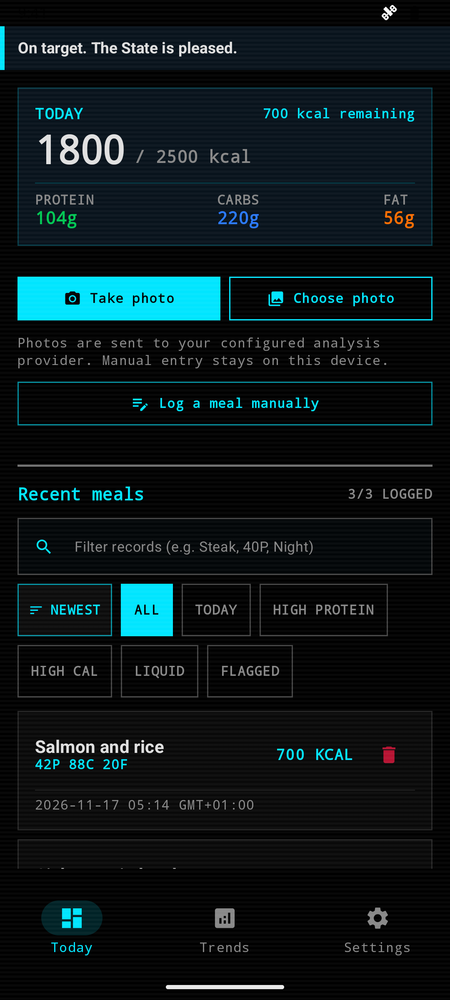
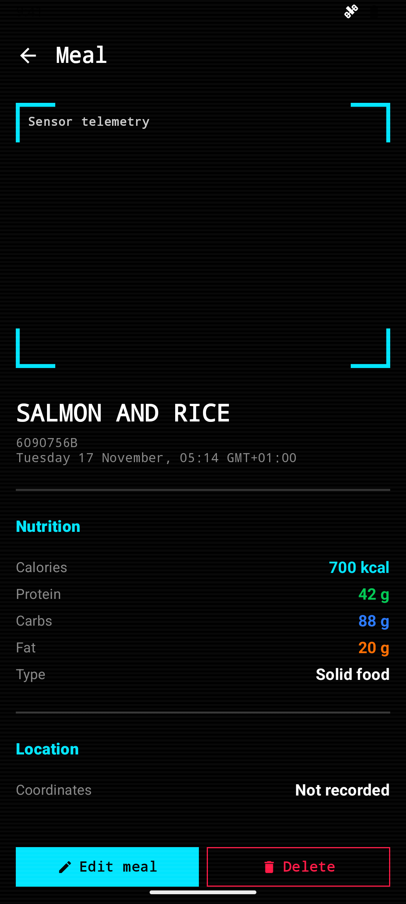
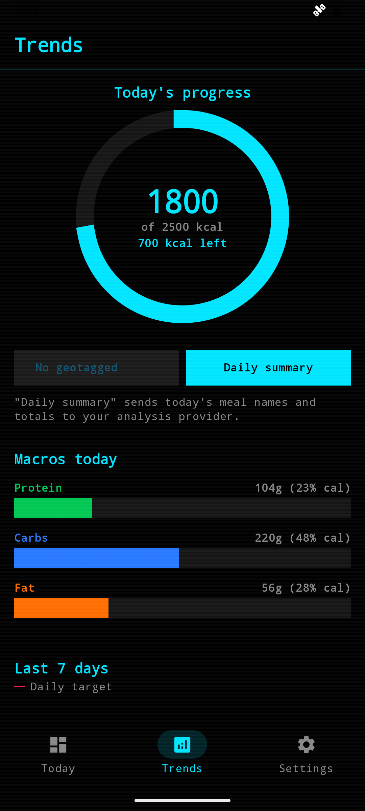
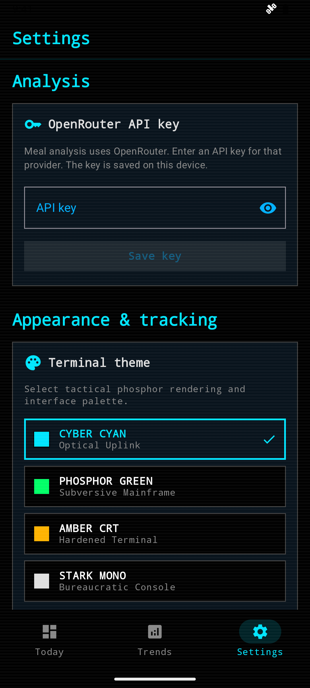

# MacroMandate

MacroMandate is an Android calorie and macro tracker with a retro terminal interface. Log meals by hand or estimate nutrition from a photo, review your daily targets and weekly trends, and keep your meal history on your device.

[Download the latest signed APK from GitHub Releases](https://github.com/shareef01/MacroMandate/releases/latest) · [Android CI](https://github.com/shareef01/MacroMandate/actions/workflows/android.yml)

## Install or update

1. Open the latest GitHub Release on an Android 10 or newer device.
2. Download `MacroMandate-<version>.apk` from **Assets**. Android may ask you to allow your browser or file manager to install the APK.
3. To update an existing install from GitHub Releases, open the new APK and choose **Update**. Keep the app installed so Android preserves its data.

Each release includes a `.sha256` file for [verifying the download](RELEASE_GUIDE.md#verify-a-downloaded-apk).

## Screenshots

<p align="center">
  
  
  
  
</p>

Screenshots show v1.0.3 with sample data.

## Use the app

- **Today** shows your calorie and macro targets and recent meals. Use **Log a meal manually** to add or edit records without an account, API key, or internet connection.
- **Photo analysis** estimates calories, protein, carbs, and fat from the camera or photo picker. Review and adjust the result before saving it.
- **Trends** shows seven-day consumption and macro breakdowns. The optional AI daily summary uses today's logged meals.
- **Settings** contains targets, terminal themes, reminders, backup and restore, and data deletion. You can export JSON backups or CSV history. The home screen widget shows today's calorie totals.

### Set up photo analysis

1. Create an [OpenRouter API key](https://openrouter.ai/settings/keys).
2. In MacroMandate, open **Settings**, enter it under **OpenRouter API key**, and choose **Save key**.
3. Return to **Today** and take or choose a photo. The default `openrouter/free` router selects a compatible free model. Availability and rate limits depend on OpenRouter.

Nutrition estimates are approximate. Review them before saving.

## Privacy

- Meal records and saved photos are stored on the device. Manually created JSON or CSV exports contain the data you choose to export.
- Photo analysis sends a resized JPEG to the configured provider. The app strips source EXIF metadata. Local meal geotagging and including coordinates in analysis images are separate opt-ins.
- When you request an AI daily summary, the app sends today's meal names and macro totals to the configured provider.
- API keys are stored in app-private preferences by provider and excluded from Android backups and app exports.

See the [privacy threat model](docs/PRIVACY_THREAT_MODEL.md) for the data flows and storage details.

## Build and test

Use Android Studio with JDK 17 and Android SDK 37. The app uses Kotlin, Jetpack Compose, Room, CameraX, and WorkManager.

```bash
./gradlew assembleDebug
./gradlew test lintDebug
./gradlew connectedDebugAndroidTest
```

On Windows, use `gradlew.bat`. Instrumented tests require an Android device or emulator. Standard builds use OpenRouter. Developers can override the endpoint and model with `MANDATE_API_BASE_URL` and `MANDATE_MODEL_ID` in their untracked `local.properties`.

- [GitHub release and signing guide](RELEASE_GUIDE.md)
- [Security and architecture audit](docs/AUDIT_REPORT.md)

## License

All rights reserved. Maintained by [Shareef](https://github.com/shareef01).
