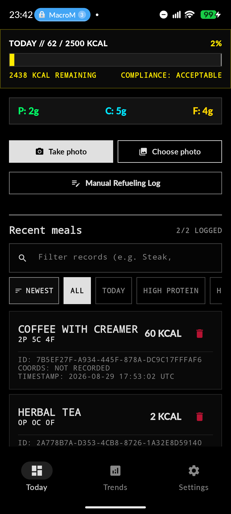

# MacroMandate 👁️📟

> **Sovereign Dietary Intelligence & Calorie Surveillance System**

**MacroMandate** is a high-performance, privacy-conscious nutrition and calorie surveillance application built for Android with Jetpack Compose. Designed with a retro tactical HUD / dystopian terminal aesthetic, it empowers users to log meals effortlessly via computer vision and barcode scanning, monitor daily macronutrient compliance, and maintain sovereign control over their health data.

---

## 📱 Visual Interface

<p align="center">
  
  
  
</p>

---

## ⚡ Key Features

- 📸 **AI Multimodal Vision**: Capture or select meals to estimate calories, protein, carbohydrates, and fats via Hugging Face multimodal vision models (`google/gemma-4-31B-it` router).
- 🏷️ **Live ML Kit Barcode Scanner**: Instant product recognition with nutrition auto-population via OpenFoodFacts integration.
- 📺 **Simulated CRT Effects**: Hardware-accelerated scanlines, radial screen vignette, and phosphor bloom shader for an authentic terminal atmosphere.
- 🛡️ **Defensive Nutrition Sanitizer**: Automated validation against malformed JSON or string-encoded quantities, with programmatic $(P\times 4 + C\times 4 + F\times 9)$ fallback calculation.
- 🔒 **Android KeyStore AES-256 GCM Encryption**: User API tokens are stored encrypted at rest using hardware-backed cryptographic keys, preventing cold storage credential extraction.
- ✍️ **Manual Refueling Fallback**: Quickly record custom meals and macros directly when offline or in low-light environments.
- ✏️ **In-Place Meal Correction**: Edit food names, calories, macros, and liquid status at any time with immediate aggregate recalculation.
- 📊 **Metabolic Adherence Dashboard**: Real-time intake HUD displaying today's calories, remaining target delta, and macronutrient distribution.
- 📈 **7-Day Trend Intelligence**: Target-scaled weekly caloric and macro visualizations with at-a-glance day metrics.
- 📑 **Weekly Dossier Summary**: Synthesize 7-day nutritional intelligence debriefs with one-tap clipboard copy and markdown export.
- 🗺️ **Geospatial Surveillance**: Opt-in coordinates watermarking and interactive meal location radar.
- 🎨 **Dynamic Terminal Themes**: Switch on-the-fly between *Cyber Cyan*, *Phosphor Green*, *Amber CRT*, and *Stark Mono*.
- ♿ **Accessibility & WCAG Compliance**: Full TalkBack screen reader semantics, minimum $48\text{dp}$ touch targets, and scalable monospace typography.
- 💾 **Data Portability & Zero Lock-in**:
  - Full **JSON Backup & Restore** (Schema V1/V2 with deduplication)
  - Standards-compliant **CSV Dossier Export** (with spreadsheet formula injection safeguards)
- 🚀 **Modern Android Compatibility**: Tested against Android SDK 37, 16 KB page-aligned native binaries, and guarded foreground service lifecycles for Android 14/15/16.

---

## 🛠️ Architecture & Tech Stack

```
┌─────────────────────────────────────────────────────────────┐
│                    JETPACK COMPOSE UI                       │
│     MainScreen  │  AnalyticsScreen  │  ControlPanelScreen   │
├─────────────────────────────────────────────────────────────┤
│                      VIEWMODEL LAYER                        │
│             MainViewModel  │  StateFlow Observers           │
├─────────────────────────────────────────────────────────────┤
│                      REPOSITORY LAYER                       │
│     MealRepository  │  AuditRepository  │  Preferences      │
├─────────────────────────────────────────────────────────────┤
│                      LOCAL DATA LAYER                       │
│   Room DB (MealEntity, AuditEntity) │ KeyStore DataStore    │
├─────────────────────────────────────────────────────────────┤
│                      NETWORK & SYSTEM                       │
│  Retrofit + OkHttp Backoff │ ML Kit Barcode │ CameraX       │
└─────────────────────────────────────────────────────────────┘
```

- **UI Framework**: Declarative Jetpack Compose with Material 3, custom CRT shaders, and tactical HUD framing modifiers.
- **Architecture**: Clean MVVM + Repository pattern with Kotlin Coroutines & StateFlow.
- **Security**: Hardware-backed `AndroidKeyStore` AES-256 GCM encryption for credentials.
- **Persistence**: Room Database with schema versioning (`v7`) and DataStore Preferences.
- **Networking**: Retrofit 2 + OkHttp 4 with automated exponential retry backoff for model cold-starts.
- **Camera & Barcode**: CameraX with downsampled bitmap decoding and ML Kit Barcode Scanning.
- **Background Tasks**: WorkManager for periodic compliance surveillance and reminder scheduling.
- **Widgets**: Jetpack Glance tactical home-screen widget.

---

## 🚀 Getting Started

### Prerequisites
- Android Studio Ladybug / Meerkat or newer.
- Android SDK 35+ (compiles against SDK 37, minimum SDK 29).
- JDK 17.

### Build and Run
```bash
# Clone the repository
git clone https://github.com/shareef01/MacroMandate.git
cd MacroMandate

# Run all unit tests
./gradlew test

# Assemble debug APK
./gradlew assembleDebug

# Install on connected device via ADB
adb install -r app/build/outputs/apk/debug/app-debug.apk
```

### Configuration (`local.properties`)
```properties
# Optional: Pre-configure Hugging Face API Token (or enter in-app in Settings)
HUGGINGFACE_API_KEY=hf_your_token_here

# Optional: Vision Model Endpoint override
MANDATE_API_BASE_URL=https://router.huggingface.co/
MANDATE_MODEL_ID=google/gemma-4-31B-it
```

---

## 🧪 Automated Testing

MacroMandate includes **63 unit tests** covering business logic, repository operations, data sanitization, cryptography, and export formatting:

```bash
./gradlew test
```

- `MealRepositoryTest`: Tests batch inserts, updates, deletions, and date filtering against in-memory DAOs.
- `KeyStoreCryptoTest`: Tests hardware-backed AES-256 GCM encryption boundaries and legacy fallback handling.
- `NutritionSanitizerTest`: Tests defensive string parsing, float conversion, negative clamps, and macro calculations.
- `DossierExporterTest`: Tests CSV escaping, timestamp formatting, and formula injection mitigation.
- `DossierReportGeneratorTest`: Tests weekly markdown synthesis, streak calculations, and macro contributions.
- `ComplianceEngineTest`: Tests adherence scoring and penalty state evaluation.
- `LeniencyVerdictTest`: Tests plea parsing and reset workflows.
- `TerminalThemeTest`: Tests dynamic palette mappings and fallback behaviors.

---

## 📄 Release & Signing

For details on configuring production signing keystores and building release APKs/AABs with R8 code shrinking enabled, refer to [RELEASE_GUIDE.md](RELEASE_GUIDE.md).

---

## 🛡️ License

Built for sovereign dietary discipline. All rights reserved.
